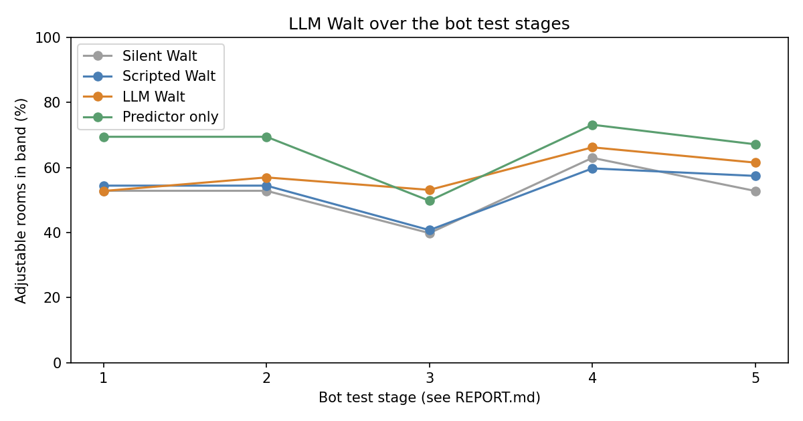
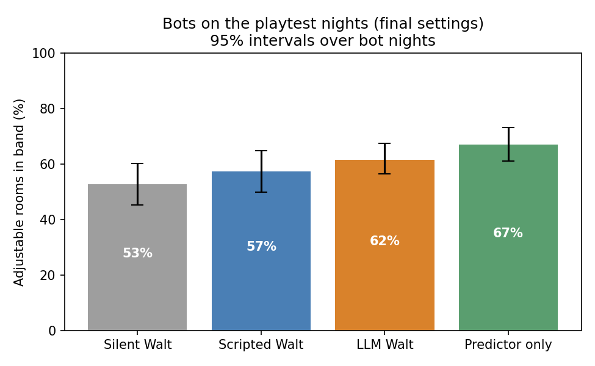
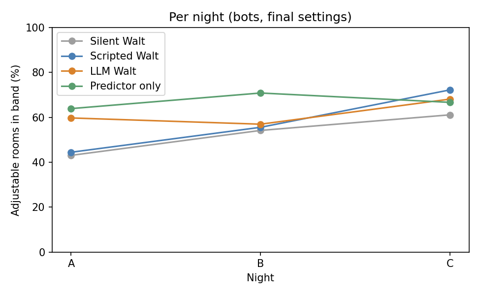
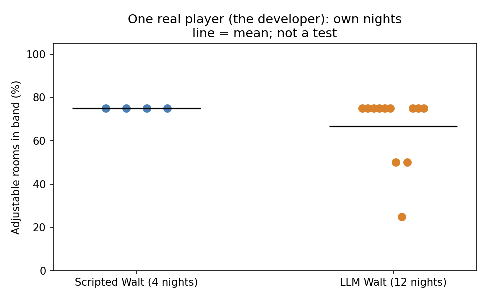

# Hollowmere: Final Report

**Skill-Adaptive AI Companion and Storyline Director: Rule-Based, Bandit and LLM Control Compared**
Case study for *Emerging Technologies and AI*, HTW Berlin. Status: 14 Nov 2026.

All numbers below were produced by the scripts in this repository and can be re-run (`python analyze_final.py`
for Study 2; the Study 1 commands are in README.md). Bot data and play data are in `data/` (not in git).

---

## 1. Question

Can an AI "director" keep a game at the right difficulty for different players, and does a language model
(LLM) add anything as a companion? Hollowmere is a turn-based ghost game in a theme park. Before every room
a director (Walt, the old mechanic) chooses how hard it is and how he helps. A room is **in band** when the
player loses 30-70% of their HP without dying: hard enough to matter, not so hard that they die. Activities
(mini-games) use the same idea: won while using 30-70% of the allowed mistakes.

## 2. Study 1: which director keeps rooms in band? (bots)

Bots (beginner, rage quitter, average, expert) played 1,000 runs per type for the non-LLM directors and 25
per type for the LLM directors (the laptop overheats). Test seeds were never used for training or tuning.

| Director | How it decides | Rooms in band |
|---|---|---|
| fixed | always the same | 55.6% |
| random | random | 44.2% |
| rule | hand-written rules on a skill estimate | 64.0% |
| bandit | learns from experience | 75.7% |
| plain LLM (llama3.2 3B) | the LLM decides from a description | 39.9% |
| LLM + risk numbers (`llm_risk`) | the LLM picks from the 6 options with the best predicted chance | 76.5% |
| predictor only (ablation) | always the best predicted option, no LLM | **78.5%** |

Findings: a plain small LLM is worse than random (it follows story logic: easy early, hard late). Given the
predicted chances, it ties the bandit, but the predictor alone is slightly better, so the gain comes from
the prediction model, not from the LLM's own judgement. The order predictor > bandit > rule > fixed held in
7 game variants (+/-20% ghost strength etc.) and for 3 of 4 unseen bot types.

## 3. Study 2: three companions in a story (bots + one real player)

The story mode ("Night of the Fire") has three nights (A, B, C), each with 3 normal fights, 1 activity
(Flashlight Search, Lake Crossing, Bucket Brigade), 2 victim ghosts with a hidden weakness, and a finale.
Three versions of Walt were built as complete companions:

| | Silent Walt | Scripted Walt | LLM Walt |
|---|---|---|---|
| Difficulty and help | always normal | rules (Study 1 rule director) | LLM picks from the best predicted options (Study 1 `llm_risk`) and says one sentence |
| Victim hints | none | fixed hint ladder | LLM decides when and what to reveal |
| Memory across nights | none | none | a player profile in every prompt |

A fourth version, **predictor only**, is the ablation: the same numbers as LLM Walt, always the best option,
no LLM.

### 3.1 Method

- **Planned:** a within-player playtest (each player meets all three Walts, one per night, in rotated orders),
  hypotheses H1-H5 fixed on 11 Nov before any data (STUDY2.md 5b). Only 4-5 players could be recruited, and
  in the end the playtest with friends did not take place before the deadline. The study is therefore
  finished with **bots as the main evidence** and **the developer's own 16 nights as a single-player case**.
- **Bots:** 3 skill types (beginner, average, expert) x 3 player types (naive: ignores weaknesses; listen:
  understands a weakness after a hint; smart: knows all weaknesses) x 2 nights x Nights A, B, C, for all
  four versions on the same seeds (54 bot nights, about 215 adjustable rooms per version).
- **Main measure (H1):** share of *adjustable* rooms in band (normal fights + the activity; victims and the
  finale excluded).
- **Uncertainty:** 95% bootstrap intervals over bot nights (2,000 resamples, seed 42); comparisons are
  *paired*: LLM Walt vs another version on exactly the same bot nights.
- **Development and test seeds were kept apart:** development 600000, tuning 610000, first final test
  620000, playtest-night check 630000, final check **640000** (fresh, run once after the last change).

### 3.2 How LLM Walt was improved (bots and pilot)

The first version sounded like scripted Walt (46% of his sentences failed the checks) and did poorly in
the activities (19%). Changes, each checked on bots:

1. **Safety net:** a choice more than 10 points worse than the best option is replaced (logged).
2. **Second sentence try:** if his sentence fails the checks, he is asked once more; own sentence 53% -> 88%.
3. **Shorter option lists:** he only sees options within 5 points of the best (step-ins first, then rooms).
4. **Two rooms were too easy for any director** and were replaced by existing stronger rooms: Night C's
   Ticket Booth (in band 6%, even on hard) -> Helter Skelter (72%); Night A's Tilted Room -> Laughing Stage
   (70%). These changes affect all versions equally.
5. **Pilot changes to the game:** a clearer Lake Crossing (dodging), the Bucket Brigade instead of a smoke
   escape, practice steps, no waiting for the model (a timeout rule), difficulty changes shown in the game
   itself (fog, speed, light) instead of as text.



*Stages: 1-2 development (bot plan with two activities per night, old and new LLM Walt), 3 first final test
(same plan), 4 the real playtest nights, 5 the playtest nights after the room fixes (final). The stages use
different nights and seeds, so they are compared within a stage, not across stages.*

### 3.3 Results: final bot test (playtest nights, final settings, fresh seeds 640000)



| Walt | Adjustable rooms in band (95% interval) | Normal fights | Activities | Too easy / too hard |
|---|---|---|---|---|
| Silent | 53% (45-60) | 64% | 19% | 31 / 16% |
| Scripted | 57% (50-65) | 64% | 39% | 33 / 10% |
| **LLM** | **62% (56-68)** | **74%** | 25% | 25 / 14% |
| Predictor only | 67% (61-73) | 75% | 43% | 19 / 14% |

**Paired on the same 54 bot nights:**

| Comparison | Mean difference (95% interval) | Nights LLM better / worse / equal |
|---|---|---|
| LLM - silent | **+9 points (+2 to +17)** | 24 / 13 / 17 |
| LLM - scripted | +5 points (-3 to +12) | 19 / 13 / 22 |
| LLM - predictor | -5 points (-12 to +2) | 15 / 20 / 19 |



| Per night | A | B | C |
|---|---|---|---|
| Silent | 43% | 54% | 61% |
| Scripted | 44% | 56% | 72% |
| LLM | 60% | 57% | 68% |
| Predictor | 64% | 71% | 67% |

- **Victim weaknesses found** ('listen' bots, H3): silent 19%, scripted 89%, LLM 75%, predictor 94%.
- **LLM Walt's behaviour:** own sentence in 88% of rooms, 1% fallbacks to scripted Walt, 0 timeouts, 5.0 s of
  model time per room (hidden while the player walks to the room).
- **By bot type:** LLM Walt helps most with experts (56% in band vs silent 39%, scripted 46%): he chose "hard"
  for them in 50 of 72 rooms, scripted Walt in 17, silent Walt never.

### 3.4 Results: one real player (the developer's own nights)



16 nights (IDs VARSHINI and PILOT1-7), all escaped; the victim's weakness was found in 24 of 32 victim
fights (75%). 12 nights with LLM Walt, 4 with
scripted Walt, none with silent Walt. Ratings were only collected for the LLM nights.

| | Nights | Adjustable rooms in band | Fun | "Did Walt help?" | "Real companion?" | "How hard?" (3 = just right) |
|---|---|---|---|---|---|---|
| Scripted Walt | 4 | 75% | - | - | - | - |
| LLM Walt | 12 | 67% | 4.0 | 3.8 | 4.0 | 3.5 |

- In her LLM nights, Walt's own sentence was used in 65% of rooms (all nights were played before the
  second-sentence fix); no decision timed out.
- "Enjoyed most": the story 3x, the challenge 3x, the fights 1x.
- This is **one person who built the game**, knew which Walt was playing, played on changing versions of the
  game, and played the same nights several times. It shows that the game and LLM Walt work with a real
  person in real time; it cannot show whether LLM Walt is better for players.

### 3.5 Hypotheses

| | Hypothesis | Bots | Real player | Verdict |
|---|---|---|---|---|
| H1 | LLM Walt keeps more adjustable rooms in band than silent Walt | +9 points (+2 to +17) | no silent nights | **Supported in bots** |
| H2 | Nights with LLM Walt feel closer to "just right" | - (bots have no feelings) | 3.5, no comparison | Not tested |
| H3 | Scripted and LLM Walt lead to more weaknesses found than silent | 89% and 75% vs 19% | 75% (no silent nights) | **Supported in bots** |
| H4 | LLM Walt feels more like a real companion | - | 4.0 / 5, no comparison | Not tested |
| H5 | Nights with LLM Walt are more fun | - | 4.0 / 5, no comparison | Not tested |

## 4. Discussion

- **The prediction model does the main work.** In both studies "predictor only" is the best or equal-best
  director. A small LLM (3B) choosing from the predicted options keeps most of that benefit (Study 1: 76.5% vs
  78.5%; Study 2: 62% vs 67%) and adds what the predictor cannot: his own sentences, hints told as a story,
  and memory of the player. Whether players value that is the open question (H4, H5).
- **LLM Walt is clearly better than no help (silent) and somewhat better than fixed rules (scripted)** at
  keeping the difficulty right, mainly in the fights and for strong players.
- **His weak spot is the activities** (25% vs 43% for the predictor). These are only about 54 activities,
  so the number is uncertain. His activities missed on both sides (23 too easy, 17 too hard of 53), while
  the predictor always chose "stay back" (no help) and got 23 of 54 in band. Why the LLM's activity choices
  miss more is not yet explained.
- **Game design matters as much as the director.** Two rooms were too easy for any director; replacing them
  raised every version. An adaptive director can only adapt within the range the game offers.
- **An LLM companion must be engineered around:** structured answers (JSON) with validation, a fallback for
  every call, a cache, background calls so the game never waits, and limits on what it may choose.

## 5. Limitations

- **No real playtest:** H2, H4 and H5 (the player's experience) could not be tested. The real-player data is
  one person, the developer, not blind to the version.
- **Bots, not people:** the bots and the prediction models come from the same simulator, which favours the
  predictor. Real players learn, get tired and react to Walt's words; bots do not.
- **Small LLM samples:** the language model is slow and overheats the laptop, so the LLM tests are 54 bot
  nights per stage (Study 1: 25 runs per bot type).
- **Changes during development:** LLM Walt and two rooms were changed after earlier bot tests. To avoid
  fitting the results, each change was checked on new seeds, and the final check (seeds 640000) was run once
  after the last change.
- **One fixed night order** (A, B, C) and three versions that differ in several ways at once: the study
  compares companions as a whole, not single features.

## 6. Conclusion

A data-driven director keeps a game at the right difficulty much better than fixed settings or simple rules.
A small local LLM, given the predicted chances, keeps most of that benefit (in the story mode: 62% of rooms
in band vs 53% without help and 67% for the prediction model alone) while acting as a talking companion with
memory. On difficulty alone, the prediction model is the better choice. The LLM's value has to come from the
companion experience, which this project could build and pilot, but not yet measure with real players. The
playtest design (STUDY2.md 5b) is ready for that next step.

## 7. Future work

What was already tried to improve LLM Walt (section 3.2): predicted chances in the prompt, short option
lists, clearer instructions, a safety net, a second try for his sentence, and options only close to the best.
Because he chooses from the prediction model's list, the predictor alone (67%) is the ceiling for difficulty;
LLM Walt is at 62%, so at most about 5 points are left. Not tried:

1. **The real playtest** (STUDY2.md 5b, ready to run): the only way to test H2, H4 and H5, whether players
   find LLM Walt more fun and more of a companion.
2. **Split the work:** the prediction model chooses the difficulty, the LLM does what only it can do (talk,
   tell the victims' stories, give hints, remember the player). On difficulty this would reach the
   predictor's level and keep the companion; the difficulty result would then belong to the prediction model.
3. **The activities:** LLM Walt's weakest part (25% vs 43% for the predictor); his activity choices and
   step-ins need a closer look, with more activity runs than the 54 here.
4. **A larger language model** (e.g. 8B instead of 3B): possibly better choices, but about three times slower
   and too heavy for the 8 GB test laptop; it would need a stronger computer or a server.

## Reproduce

```bash
python analyze_final.py          # Study 2 tables (figures/final_*.csv) and figures (figures/final_*.png)
python story_brains_check.py --brains silent scripted predictor --games 2 --first-seed 640000
python story_brains_check.py --brains llm --nights A --games 2 --first-seed 640000   # then B, C (Ollama, charger)
```
